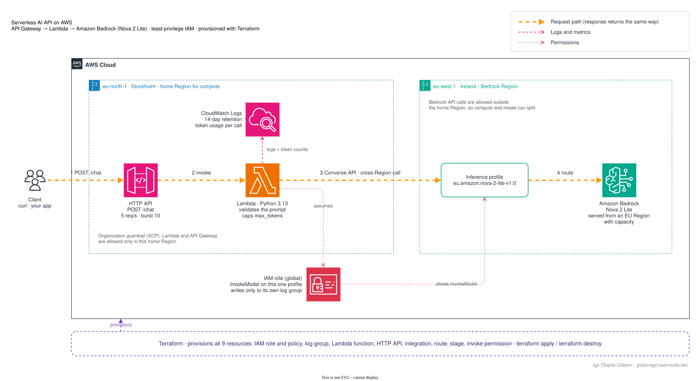

# Serverless AI API on AWS: Bedrock + Lambda + Terraform

An HTTPS endpoint that takes a prompt and returns a response from Amazon Nova 2 Lite on Amazon Bedrock. Built with API Gateway (HTTP API), AWS Lambda (Python 3.13) and Terraform, with a least-privilege IAM policy scoped to one inference profile.



The orange arrows show the request path. Lambda and API Gateway run in one Region and call Bedrock in another (see [Deploying in an AWS Organization account](#deploying-in-an-aws-organization-account) for why). The editable source is [`docs/architecture.drawio`](docs/architecture.drawio); open it at [app.diagrams.net](https://app.diagrams.net).

📖 **Full write-up:** [Build a Serverless AI API on AWS with Bedrock, Lambda and Terraform](https://gideonige.hashnode.dev/serverless-ai-api-aws-bedrock-lambda-terraform)

## Prerequisites

- An AWS account and credentials configured locally (`aws configure` or SSO)
- Terraform 1.5 or newer
- Amazon Bedrock available in your Region (defaults to `us-east-1`)

## Deploy

```bash
terraform init
terraform apply
```

## Test

```bash
curl -s -X POST "$(terraform output -raw chat_endpoint)" \
  -H "Content-Type: application/json" \
  -d '{"prompt": "Explain AWS Lambda cold starts in two sentences."}'
```

## Use a different Region or model

Override variables in a `terraform.tfvars` file (it is git-ignored). Lambda and API Gateway deploy to `aws_region`; the function calls Bedrock in `bedrock_region`, which defaults to the same Region. Splitting them helps when an organization only allows compute in some Regions:

```hcl
aws_region           = "eu-north-1"
bedrock_region       = "eu-west-1"
inference_profile_id = "eu.amazon.nova-2-lite-v1:0"
```

Check the model card in the Bedrock docs for the inference profile ID that matches your Region's geography.

## Deploying in an AWS Organization account

If `terraform apply` fails with *"explicit deny in a service control policy"*, your organization blocks that service or Region, and no IAM permission can override it. Member accounts can't read their SCPs, so `scripts/probe-account.sh` finds out by testing:

```bash
bash scripts/probe-account.sh                        # default Regions
bash scripts/probe-account.sh eu-north-1 eu-west-1   # Regions you choose
```

For each Region it creates and immediately deletes a throwaway HTTP API and Lambda function (with and without tags), and makes one 5-token Bedrock call. Results look like this:

```
=== eu-north-1 ===
Bedrock (Nova 2 Lite) ....... OK (eu profile)
API Gateway, no tags ........ OK
Lambda, no tags ............. BLOCKED by organization SCP
```

It costs a fraction of a cent, but each Bedrock call counts against your token quota. Use the results to set `aws_region` (where API Gateway and Lambda are allowed) and `bedrock_region` (where Bedrock calls work) in `terraform.tfvars`.

## Clean up

```bash
terraform destroy
```

## Files

| File | Purpose |
| --- | --- |
| `src/handler.py` | Lambda function that calls the Bedrock Converse API |
| `versions.tf` | Terraform and provider versions |
| `variables.tf` | Region, model and throttling settings |
| `iam.tf` | Lambda role and least-privilege Bedrock policy |
| `lambda.tf` | Function, packaging and log group |
| `api.tf` | HTTP API, route, stage throttling and invoke permission |
| `outputs.tf` | Endpoint URL and function name |
| `scripts/probe-account.sh` | Tests which Regions and services an organization account allows |
| `docs/architecture.*` | Architecture diagram: editable draw.io source, animated SVG and GIF, static PNG |
